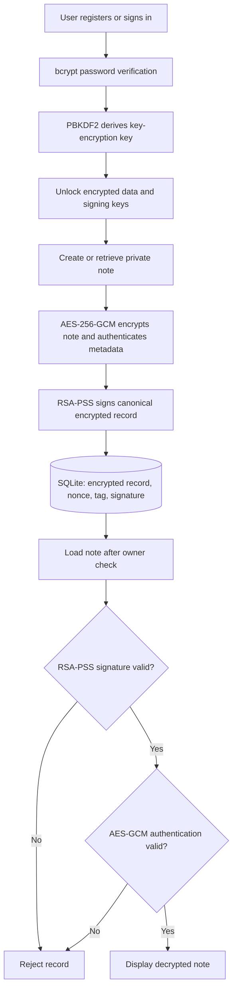

# CipherNotes

### Secure, encrypted notes with authenticated encryption and digital signatures

**CipherNotes** is a local-first, command-line note management application built with Python. It allows users to create personal accounts, write and organize private notes, and retrieve their information while keeping note contents encrypted at rest. Beyond confidentiality, the application uses authenticated encryption and digital signatures to detect unauthorized changes and verify the origin of signed records.

CipherNotes brings together several essential areas of applied cryptography—password authentication, key derivation, symmetric encryption, message integrity, asymmetric digital signatures, and secure key management—into a single, understandable system.

It was designed as a final project for **Cryptography and Computer Security at Universidad Carlos III de Madrid (UC3M)**, with a focus on correct use of established cryptographic libraries, explicit security decisions, and reproducible positive and negative tests.

## Overview

A conventional notes application stores its content in a form the application—or anyone who can read its database—can immediately access. CipherNotes takes a different approach: a user's notes are encrypted before they are saved, and the cryptographic keys required to read them are themselves protected.

Each user has an account with an independently protected set of keys. After authentication, the application unlocks the keys needed for the session and provides a simple interface for creating, listing, reading, and verifying notes. The SQLite database stores encrypted data and associated cryptographic information rather than plaintext note contents.

The application is deliberately local: it does **not** require a web server, cloud account, external identity provider, or network connection.

## Core capabilities

| Capability | How CipherNotes provides it |
| --- | --- |
| **User registration and sign-in** | Passwords are verified using **bcrypt**, including an individual salt and a configurable work factor. |
| **Confidential note storage** | Note titles and bodies are encrypted using **AES-256-GCM** before being persisted. |
| **Authenticated decryption** | GCM authentication tags ensure corrupted or modified encrypted content is rejected rather than displayed. |
| **Digital signatures** | Each encrypted note record is signed with **RSA-PSS and SHA-256**, and the signature is checked when the note is accessed or explicitly verified. |
| **Password-based key protection** | **PBKDF2-HMAC-SHA-256** derives a key-encryption key to protect stored cryptographic secrets. |
| **Per-user isolation** | Notes and their corresponding cryptographic keys are associated with the authenticated account. |
| **Persistent local storage** | **SQLite** stores user records, encrypted notes, public verification keys, and protected key material. |
| **Tamper detection** | The application rejects modified ciphertext, tags, signatures, and authenticated metadata. |

## How CipherNotes works

### 1. Account creation and authentication

During registration, a user chooses a password. CipherNotes creates a salted **bcrypt** password hash and stores only the verifier—not the plaintext password. When the user signs in, the supplied password is checked against this stored hash.

A separate **PBKDF2-HMAC-SHA-256** operation, with its own random salt and documented iteration parameters, derives a **key-encryption key (KEK)** from the user's password. This is a distinct operation from bcrypt authentication: the bcrypt hash verifies the password, while the KEK protects encryption and signing keys.

The application creates a random **256-bit data-encryption key (DEK)** for the user's notes, together with an **RSA signing key pair**. The DEK and the RSA private key are stored only in encrypted form. The public key can be stored in plaintext because it is used for signature verification rather than signing.

### 2. Creating an encrypted note

The user enters a note title and its content. CipherNotes combines these fields into a defined message format and encrypts them with **AES-256-GCM**, using the account's DEK and a fresh nonce for that encryption.

AES-GCM provides two properties together:

- **Confidentiality:** someone who reads the database cannot recover a note's plaintext without its encryption key.
- **Integrity and authenticated encryption:** changes to ciphertext or authenticated associated data cause tag verification to fail.

The note's identifier, account association, and record-format version are bound to the encrypted content using **additional authenticated data (AAD)**. This helps prevent an encrypted note from being silently moved between accounts or relabeled as a different record.

### 3. Digitally signing the encrypted record

CipherNotes uses the user's protected **RSA private key** to sign a canonical representation of the encrypted record with **RSA-PSS and SHA-256**. The signature covers the relevant metadata, nonce, and encrypted content, so that the same exact information is verified later.

Signing the encrypted representation avoids requiring the plaintext merely to check its signature. Verification uses the corresponding **RSA public key** associated with the account.

A successful signature check indicates that the record matches a signature produced by the holder of the corresponding private key. This is **not** the same as proving a real-world identity: CipherNotes associates public keys with local accounts and does not implement a certification authority or a full public-key infrastructure.

### 4. Reading and verifying a note

When a user requests a note, the application:

1. Confirms that the note belongs to the authenticated account.
2. Loads the encrypted record and its metadata from SQLite.
3. Verifies the RSA-PSS digital signature against the account's registered public key.
4. Attempts AES-GCM authenticated decryption using the correct key, nonce, and AAD.
5. Displays the title and plaintext body **only after all required checks succeed**.

An incorrect password, unavailable key, invalid signature, altered tag, or authentication failure produces a controlled error. The application does not treat unauthenticated data as valid content.

### Cryptographic workflow

*The diagram summarizes the record-creation and record-reading paths; encryption and signing are not repeated when an existing note is merely opened.*

## Cryptographic architecture

| Security objective | Algorithm / mechanism | Implementation role |
| --- | --- | --- |
| Password authentication | **bcrypt** | Salted, intentionally expensive verification of user passwords. |
| Password-based key derivation | **PBKDF2-HMAC-SHA-256** | Derives a KEK using a separate salt and an appropriately selected iteration count. |
| Symmetric encryption | **AES-256-GCM** | Encrypts note payloads and protects serialized private keys and the DEK. |
| Message integrity | **AES-GCM authentication tag** | Rejects tampered ciphertext and authenticated metadata. |
| Digital signatures | **RSA-PSS + SHA-256** | Signs and verifies encrypted note records. |
| Random value generation | **Cryptographically secure random source** | Generates salts, secret keys, and GCM nonces. |
| Data persistence | **SQLite** | Stores protected data and non-secret metadata locally. |

The cryptographic operations are performed using established Python libraries, primarily **`cryptography`** and **`bcrypt`**, rather than custom implementations of AES, RSA, or password hashing.

### Key generation and storage

CipherNotes separates keys according to their purpose:

- **Password verifier:** the bcrypt output is used exclusively for authenticating a supplied password.
- **Key-encryption key (KEK):** a PBKDF2-derived key protects other keys and is recomputed when required; it is not stored as a plaintext persistent secret.
- **Data-encryption key (DEK):** a randomly generated 256-bit AES key encrypts the user's notes.
- **RSA private signing key:** used for generating signatures, serialized and encrypted before storage.
- **RSA public verification key:** used to verify signatures and associated with the corresponding local user account.

The DEK and private signing key are encrypted under the KEK using **AES-GCM**, with distinct nonces for distinct encryption operations. Salts, nonces, protected key blobs, and algorithm parameters can be stored because their secrecy is not required; the underlying passwords and unencrypted private keys are not saved to the database or printed in logs.

GCM nonces are generated with a cryptographically secure random generator and managed to avoid reuse with the same key. Nonce handling is part of the application's security tests because reuse of a key–nonce pair can compromise AES-GCM security.

### Data model

The local database separates account information from notes:

| Record | Stored information |
| --- | --- |
| **User account** | User identifier, bcrypt verifier, PBKDF2 salt and parameters, encrypted DEK, encrypted RSA private key, RSA public key, and relevant nonce/format metadata. |
| **Encrypted note** | Note identifier, owner identifier, format/version metadata, GCM nonce, encrypted payload and authentication tag, and RSA-PSS signature. |

Note titles and bodies are part of the **encrypted payload**. Identifiers, record sizes, and other non-sensitive operational metadata may remain visible to someone who can inspect the database.

## Security validation

CipherNotes is designed to demonstrate both successful cryptographic operations and **safe failure under tampering or incorrect credentials**.

| Test case | Expected result |
| --- | --- |
| Valid registration and sign-in | User is authenticated and their protected keys can be unlocked. |
| Incorrect password | Authentication is denied and no protected data is exposed. |
| Normal note encryption/decryption | The original title and body are recovered correctly. |
| Modified ciphertext or GCM tag | Authenticated decryption fails; no plaintext is returned. |
| Modified AAD or note ownership metadata | Verification or authenticated decryption rejects the record. |
| Invalid or altered RSA signature | Signature verification fails and the record is rejected. |
| Incorrect decryption key | The GCM authentication check fails. |
| Corrupt or malformed database record | The application raises a controlled error without revealing secrets. |

The project also analyzes relevant threats and their mitigations:

- **Offline password guessing:** mitigated through bcrypt and a computationally expensive PBKDF2 derivation, both with individual salts.
- **Unauthorized modification of stored notes:** detected through AES-GCM authentication and digital signature verification.
- **Private-key exposure:** reduced by storing the DEK and RSA private key in authenticated encrypted form instead of plaintext.
- **Unauthorized access across accounts:** restricted by account ownership checks and per-user cryptographic keys.

## Software design

The application follows a modular architecture so that the user interface, authentication logic, cryptographic operations, and persistence layer have separate responsibilities.

| Component | Responsibility |
| --- | --- |
| **Command-line interface** | Registration, sign-in, note operations, clear error messages, and session management. |
| **Authentication layer** | User enrollment, bcrypt verification, and PBKDF2 parameters. |
| **Encryption and key-management layer** | DEK generation, AES-GCM operations, protected secret storage, and nonce management. |
| **Signature layer** | RSA key generation, canonical record signing, and signature verification. |
| **Persistence layer** | SQLite account and note records, ownership checks, and database updates. |
| **Test suite** | Functional tests, negative security tests, and reproducible failure cases. |

A typical user interaction follows this sequence: **register → sign in → create an encrypted note → list and read personal notes → verify a note's signature → sign out**.

## Security scope and limitations

CipherNotes is an **educational security project**, not an independently audited commercial secure-storage product. Its guarantees depend on correct implementation and the security of the device running it.

- It protects **note contents at rest**, but it does not protect against a compromised operating system, malware, or an attacker who can read the user's password or application memory during an active session.
- A valid RSA signature establishes a relationship to a **locally associated public key**, not to a government-issued or publicly certified identity. No complete PKI or certificate revocation system is provided.
- AES-GCM and RSA signatures detect unauthorized modifications but do **not inherently prevent deletion, rollback to an older valid database, or denial of service**.
- Metadata such as the existence, number, and approximate sizes of notes may remain observable.
- The application operates locally and does not include cloud synchronization, collaborative editing, account recovery, or an external authentication service.

## Technologies

**Language:** Python  
**Cryptographic libraries:** `cryptography`, `bcrypt`  
**Storage:** SQLite  
**Interface:** Command line  
**Core concepts:** authenticated encryption (AEAD), password hashing, password-based key derivation, digital signatures, cryptographic key management, and security testing

## Academic context

CipherNotes integrates concepts studied in the **Cryptography and Computer Security** course at **Universidad Carlos III de Madrid (UC3M)**. Its design builds on coursework covering secure password storage (including bcrypt and PBKDF), AES-GCM authenticated encryption, RSA signatures, and the distinction between signature verification and certificate-based identity validation.

The use of **RSA-PSS** is a security-oriented adaptation of the RSA signing exercises, rather than a claim that the exact RSA-PSS implementation was supplied in the practical handouts.

---

**CipherNotes — Private notes, authenticated encryption, verifiable integrity.**
